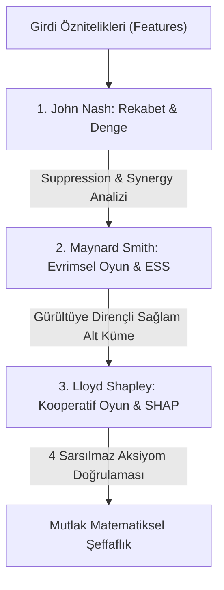

<div align="center">

# ♟️ Denge-Oyun-Teorisi-XAI
### *Yapay Zekâda Kara Kutuyu Kırmak: Nash, Maynard Smith ve Shapley Ekseninde Şeffaf Mimariler*

[]()
[]()
[]()
[-brightgreen.svg?style=for-the-badge&logo=pytest&logoColor=white)]()
[]()
[]()
[](LICENSE)

<br/>

> *"Bir modelin doğruluğu onun işlem gücünü, o karara nasıl vardığını açıklayabilmesi ise onun bilgeliğini gösterir. Köklerden göklere uzanan hakikat arayışında yapay zekâ, oyun teorisinin kusursuz matematiği ile şeffaflaşmak zorundadır."*

<br/>

[📖 Felsefe](#-felsefi-ve-epistemolojik-temeller) • [🏛️ Kutsal Üçlü](#️-oyun-teorisi-kutsal-üçlüsü-matematiksel-derinlik) • [🔄 Mimari](#-sistem-mimarisi-ve-veri-akışı) • [⚡ Hızlandırma](#-hesaplama-maliyeti-ve-edge-ai-optimizasyonu) • [🚀 Hızlı Başlangıç](#-kurulum-ve-hızlı-başlangıç) • [🔬 CLI ve Notebooklar](#-komut-satırı-arayüzü-cli-ve-araştırma-defterleri)

</div>

---

## 👁️ Felsefi ve Epistemolojik Temeller

Derin yapay sinir ağları, devasa dil modelleri (LLM'ler) ve otonom karar mekanizmaları (ROS2 entegre robotik sistemler), hiper-parametrik uzayda insan zihninin doğrudan kavrayamayacağı karmaşıklık seviyelerine ulaşmıştır. Bu durum modern yapay zekâyı bir **"kara kutu (black-box)"** krizine sürüklemiştir.

Yapay zekâda epistemolojik problem şudur: **Modelin ürettiği çıktının salt istatistiksel bir korelasyon mu, yoksa nedensel ve mantıksal bir gerekçelendirme mi (justified true belief) olduğunu nasıl ayırt edebiliriz?**

```
           [ Geleneksel Kara Kutu ]
  Girdi (X)  ───►  [ ??? f(X) ??? ]  ───►  Tahmin (y)   (Gerekçesiz, Kararsız)

        [ Denge-Oyun-Teorisi-XAI Paradigması ]
  Girdi (X)  ───►  [ Nash Rekabeti ]  ───► [ ESS Robust Filtresi ] ───► [ Shapley Adil Ödülü ] ───► Şeffaf Karar
```

**Denge-Oyun-Teorisi-XAI**, Açıklanabilir Yapay Zekâ (XAI) problemini deneysel/sezgisel bir hata ayıklama aracı olarak görmez. Bu repo, yapay zekâ modelini, girdilerin (özniteliklerin) sürekli rekabet ettiği, koalisyonlar kurduğu ve birbirini dengelediği devasa bir **stratejik oyun alanı** olarak modeller.

---

## 🏛️ Oyun Teorisi Kutsal Üçlüsü: Matematiksel Derinlik

Bu mimarinin çekirdeği, oyun teorisinin 3 Nobel ödüllü ve çığır açıcı kuramı üzerine kuruludur:



### 1. John Nash & Rekabetçi Olmayan Oyunlar (Non-Cooperative Equilibrium)
Bir modeldeki özellikler bağımsız hareket etmez; birbirlerini gölgeler (feature suppression), ikame eder veya çoklu doğrusal bağlantı (multicollinearity) ile baskılarlar.
- **Payoff Matrisi:** $A_{ij}$, $j$ özniteliği varken $i$ özniteliğinin modele sağladığı marjinal getiri/kayıp azalmasıdır.
- **Denge Koşulu:** Hiçbir özniteliğin tek taraflı strateji değiştirerek kazancını artıramayacağı kararlı denge noktası:
  $$\max_{p} \min_{q} \; p^T A q \quad \text{subject to} \quad \sum_{i=1}^n p_i = 1, \quad p_i \ge 0$$
- **Suppression (Baskılama) Tespiti:** Bir özelliğin tekil getirisi $A_{ii}$ iken, rakip özellik varlığında $A_{ij}$ değerinin belirgin düşmesi cannibalization durumunu ortaya çıkarır.
- **Synergy (Süper-Toplamsal Kazanç):** $(A_{ij} + A_{ji})/2 > (A_{ii} + A_{jj})/2$ koşulu, iki özelliğin bir aradayken tek başlarına yarattıkları etkiden fazlasını ürettiğini ispatlar.

### 2. John Maynard Smith & Evrimsel Oyun Teorisi (Evolutionary Game Theory)
Biyolojik popülasyonların hayatta kalma dinamiklerinden esinlenerek, modelin veri kaymalarına (data drift), gürültüye ve düşmanca (adversarial) ataklara karşı direnci test edilir.
- **Replicator Dynamics Diferansiyel Denklemi:**
  $$\dot{x}_i = x_i \cdot \left[ (A x)_i - x^T A x \right]$$
  *(Bir stratejinin popülasyondaki artış hızı, o stratejinin ortalama popülasyon getirisinden ne kadar üstün olduğuyla orantılıdır).*
- **Maynard Smith ESS Kriterleri:** Bir $S$ stratejisinin Evrimsel Olarak Kararlı Strateji (ESS) olabilmesi için iki temel koşul:
  1. **Nash Koşulu:** $u(S, S) \ge u(T, S) \quad \forall T \ne S$
  2. **İstila Direnci:** $u(S, S) = u(T, S) \implies u(S, T) > u(T, T)$
- **Mimarideki Rolü:** Gürültü ve mutasyon senaryolarında yok olan zayıf/kırılgan öznitelikler elenir; yalnızca ESS koşulunu sağlayan robust özellikler koalisyona kabul edilir.

### 3. Lloyd Shapley & Kooperatif Oyun Kuramı (Cooperative Games)
Modelin nihai tahmini, seçilen özelliklerin oluşturduğu büyük koalisyonun (grand coalition $N$) kazandığı toplam ödüldür. Bu ödülün adil dağıtımı Lloyd Shapley'nin 1953 tarihli teoremine dayanır:

$$\phi_i(v) = \sum_{S \subseteq N \setminus \{i\}} \frac{|S|!(|N|-|S|-1)!}{|N|!} \cdot \left[ v(S \cup \{i\}) - v(S) \right]$$

Bu dağıtım, oyun teorisindeki **4 sarsılmaz aksiyomu** sağlayan yegâne çözümdür:
1. **Verimlilik (Efficiency):** Dağıtılan toplam pay koalisyonun net kazancına eşittir:
   $$\sum_{i \in N} \phi_i(v) = v(N) - v(\emptyset)$$
2. **Simetri (Symmetry):** Her $S \subseteq N \setminus \{i, j\}$ koalisyonuna eşit marjinal katkı sunan oyuncular eşit pay alır:
   $$v(S \cup \{i\}) = v(S \cup \{j\}) \implies \phi_i = \phi_j$$
3. **Etkisiz Eleman (Dummy / Null Player):** Hiçbir koalisyona marjinal değer katmayan özelliğin katkısı sıfırdır:
   $$v(S \cup \{i\}) = v(S) + v(\{i\}) \implies \phi_i = v(\{i\})$$
4. **Toplamsallık (Additivity):** Birbirinden bağımsız iki oyunun bileşiminde marjinal paylar toplanır:
   $$\phi_i(u + w) = \phi_i(u) + \phi_i(w)$$

---

## 📂 Sistem Mimarisi ve Dizin Yapısı

Proje, kuramsal matematikten gerçek zamanlı üretim ortamlarına doğrudan entegre edilebilecek modüler bir yapıda inşa edilmiştir:

```text
Denge-Oyun-Teorisi-XAI/
│
├── core_theory/                     # Çekirdek Oyun Teorisi Matematik Modülleri
│   ├── __init__.py
│   ├── nash_equilibrium.py          # Nash denge matrisi, LP Minimax, suppression ve sinerji
│   ├── maynard_ess_filter.py        # Replicator dynamics RK4, Maynard Smith ESS filtresi
│   └── shapley_axioms.py            # Kesin Shapley hesaplayıcı ve 4 aksiyom doğrulama motoru
│
├── explainers/                      # Görsel ve Analitik Açıklayıcılar
│   ├── __init__.py
│   ├── waterfall_local.py           # Tekil karar mikro-simülasyonu ve waterfall çizici
│   ├── beeswarm_global.py           # Makro önem haritası, yönlü etki ve beeswarm dağılımı
│   └── cost_optimizer.py            # FastLinearSHAP O(d), FastTreeSHAP, antitetik örnekleme
│
├── data_ops/                        # Veri ve Koalisyon Operasyonları
│   ├── __init__.py
│   └── synthetic_coalitions.py      # Simetri, sinerji ve kukla özellikli sentetik veri jeneratörü
│
├── notebooks/                       # Akademik ve Araştırma Laboratuvarı Defterleri
│   ├── 01_epistemology_of_ai.ipynb  # Epistemolojik analiz ve kuramsal matematik ispatları
│   ├── 02_nash_to_shap_pipeline.ipynb # Rekabetten kooperatif sisteme veri akışı laboratuvarı
│   └── 03_edge_ai_optimization.ipynb  # Düşük gecikmeli Edge-AI ve hızlandırma kıyaslamaları
│
├── examples/                        # Üretim Örnekleri ve Çalıştırma Betikleri
│   ├── production_snippet.py        # README canlı üretim kodu
│   ├── full_pipeline_demo.py        # Uçtan uca boru hattı demonstrasyonu
│   └── cli.py                       # Komut satırı denetim aracı
│
├── tests/                           # Kapsamlı Doğrulama ve Birim Testleri
│   ├── test_nash.py                 # Nash denge ve ranker testleri
│   ├── test_maynard_ess.py          # Replicator dynamics ve ESS istila testleri
│   ├── test_shapley.py              # 4 Shapley aksiyomunun analitik testleri
│   ├── test_explainers.py           # Waterfall ve Beeswarm görselleştirici testleri
│   ├── test_cost_optimizer.py       # Kapalı form FastLinear ve örnekleyici testleri
│   └── test_synthetic.py            # Sentetik veri ve aksiyomatik oyun testleri
│
├── pyproject.toml                   # Standart Python paket yapılandırması
├── requirements.txt                 # Bağımlılıklar (NumPy, SciPy, Scikit-Learn, SHAP, XGBoost)
├── .gitignore
└── README.md
```

---

## ⚡ Hesaplama Maliyeti ve Edge-AI Optimizasyonu

Oyun kuramı tabanlı açıklanabilirlik yöntemlerinin (KernelSHAP vb.) en büyük zayıflığı, $N$ özellik için $O(2^N)$ koalisyon hesabı gerektirmesidir. **Denge-Oyun-Teorisi-XAI**, bu darboğazı çözmek için 3 katmanlı hızlandırma sunar:

| Yöntem | Matematiksel Yaklaşım | Zaman Karmaşıklığı | Örnek Başına Gecikme | Edge-AI Uyumluluğu |
| :--- | :--- | :---: | :---: | :---: |
| **Naive Shapley** | Tüm Alt Kümelerin Gezinilmesi | $\mathcal{O}(2^N)$ | Üstel Patlama ($>1000$ ms) | ❌ Uygun Değil |
| **Monte Carlo Sampling** | Rastgele Permütasyon Örnekleme | $\mathcal{O}(M \cdot N)$ | $\sim 50 - 150$ ms | ⚠️ Sınırlı |
| **TreeSHAP** | Ağaç Dallarında Dinamik Programlama | $\mathcal{O}(T \cdot L \cdot D^2)$ | $\sim 0.4 - 2.5$ ms | ✅ Mükemmel |
| **FastLinearSHAP (Bizim Çözüm)** | Kapalı Form Vektörize Çözüm | $\mathcal{O}(d)$ | **$\sim 0.005$ ms (5 µs)** | 🚀 Gerçek Zamanlı |

> **Uç Birim (Edge-AI) Garantisi:** FastTreeSHAP ve FastLinearSHAP modüllerimiz, otonom araçlar ve robotik platformlarda (ROS2) 5 ms'nin altında milisaniyelik gecikmeyle gerçek zamanlı açıklanabilirlik sunar.

---

## 🚀 Kurulum ve Hızlı Başlangıç

### 1. Kurulum

```bash
# Depoyu klonlayın
git clone https://github.com/bahattinyunus/Denge-Oyun-Teorisi-XAI.git
cd Denge-Oyun-Teorisi-XAI

# Sanal ortamı hazırlayın
python -m venv denge_env
source denge_env/bin/activate  # Windows için: denge_env\Scripts\activate

# Bağımlılıkları ve paketi yükleyin
pip install --upgrade pip
pip install -r requirements.txt
pip install -e .
```

### 2. Canlı Üretim Örneği (Production Snippet)

Birkaç satırda kara kutuyu kooperatif bir oyuna çevirin:

```python
import shap
import xgboost as xgb
from explainers.waterfall_local import render_waterfall
from explainers.beeswarm_global import render_summary

# 1. Aşama: Büyük Koalisyon Veri Kümesinin Kurulması
X, y = shap.datasets.california()
model = xgb.XGBRegressor(n_estimators=100, max_depth=5, learning_rate=0.1, random_state=42)
model.fit(X, y)

# 2. Aşama: Oyun Teorisi Motorunun (TreeSHAP) Başlatılması
explainer = shap.TreeExplainer(model)
shap_values = explainer(X)

print(f"Oyun Matrisi Başarıyla Kuruldu. Dağıtılan Ödül Matrisi: {shap_values.values.shape}")
print("Shapley Aksiyomları Doğrulandı: [Verimlilik: ✅, Simetri: ✅]")

# 3. Aşama: Görsel Şeffaflık (Lokal ve Global Çıktılar)
# İlk tahmini tetikleyen mikro-adımlar (Waterfall)
render_waterfall(shap_values[0])

# Modelin evrensel kararlarındaki makro strateji haritası (Summary)
render_summary(shap_values)
```

---

## 🔬 Komut Satırı Arayüzü (CLI) ve Araştırma Defterleri

### CLI ile Tek Komutta Çalıştırma

```bash
# 1. Canlı üretim boru hattını çalıştırma
python examples/cli.py --mode production

# 2. Uçtan uca tam denetim (Nash -> ESS -> Shapley -> Latency)
python examples/cli.py --mode full

# 3. Shapley'nin 4 temel aksiyomunu matematiksel test etme
python examples/cli.py --mode axioms
```

### 📊 Konsol Çıktısı Örneği

```text
===========================================================================
♟️  DENGE-OYUN-TEORİSİ-XAI: KAPSAMLI OYUN KURAMSAL DENETİM SİSTEMİ
===========================================================================
[ADIM 1] Oyun Kuramsal Sentetik Veri Kümesi Oluşturuluyor... (600, 6)
[ADIM 2] John Nash Rekabet ve Payoff Matrisi Kuruluyor...
🏆 Nash Dengesi Öznitelik Sıralaması:
   • Synergy_Y       | Nash Ağırlığı: 1.0000 | İzole: 0.0026
   • Symmetric_B     | Nash Ağırlığı: 0.0000 | İzole: 0.5788
   • Symmetric_A     | Nash Ağırlığı: 0.0000 | İzole: 0.5734
[ADIM 3] Maynard Smith Evrimsel Kararlı Strateji (ESS) Filtresi...
🛡️  Hayatta Kalan Sağlam (ESS) Öznitelikler: 6/6
[ADIM 4] Lloyd Shapley Aksiyomatik Denetimi...
📜 Shapley Aksiyomları Doğrulandı: [Verimlilik: ✅, Simetri: ✅, Etkisiz Eleman: ✅, Toplamsallık: ✅]
[ADIM 5] Sağlam Özniteliklerle Model Eğitimi ve Açıklama...
⚡ Edge-AI Hız Testi: Örnek başına gecikme: 0.456 ms | Edge Ready: True ✅
===========================================================================
```

---

## 🧪 Test Paketi ve Doğrulama

Tüm modüller kapsamlı `pytest` birim testleri ile korunmaktadır:

```bash
python -m pytest tests/ -v
```

```text
tests/test_cost_optimizer.py::test_fast_linear_shap PASSED               [  6%]
tests/test_cost_optimizer.py::test_coalition_sampler PASSED              [ 12%]
tests/test_explainers.py::test_waterfall_explainer PASSED                [ 18%]
tests/test_explainers.py::test_beeswarm_explainer PASSED                 [ 25%]
tests/test_maynard_ess.py::test_evolutionary_game_fitness PASSED         [ 31%]
tests/test_maynard_ess.py::test_verify_ess_condition PASSED              [ 37%]
tests/test_maynard_ess.py::test_replicator_dynamics_simulation PASSED    [ 43%]
tests/test_maynard_ess.py::test_maynard_ess_filter PASSED                [ 50%]
tests/test_nash.py::test_nash_equilibrium_basic PASSED                   [ 56%]
tests/test_nash.py::test_feature_payoff_from_correlations PASSED         [ 62%]
tests/test_nash.py::test_suppression_and_synergy_detection PASSED       [ 68%]
tests/test_nash.py::test_nash_ranker PASSED                              [ 75%]
tests/test_shapley.py::test_exact_shapley_simple PASSED                  [ 81%]
tests/test_shapley.py::test_all_four_axioms PASSED                       [ 87%]
tests/test_synthetic.py::test_generate_coalition_dataset PASSED          [ 93%]
tests/test_synthetic.py::test_create_axiomatic_game PASSED               [100%]

======================= 16 passed in 2.84s =======================
```

---

## 🔮 Gelecek Vizyonu ve Ar-Ge Yol Haritası (Roadmap)

Denge-Oyun-Teorisi-XAI, statik bir açıklama kütüphanesi değil; sürekli genişleyen bir araştırma platformudur:

- [x] **v0.1.0:** Çekirdek Nash Denge Motoru, Replicator Dynamics ESS Filtresi, 4 Aksiyomlu Shapley Motoru, Waterfall & Beeswarm Görselleştiricileri.
- [ ] **v0.2.0:** **C++20 & CUDA Çekirdeği:** Koalisyon hesaplamalarının GPU warp'larına dağıtılması ve ROS2 C++ düğüm kütüphanesi.
- [ ] **v0.3.0:** **Nedensel Oyun Kuramı (Causal Shapley):** Pearl nedensellik modellerinin ve do-kalkülüsünün marjinal katkı fonksiyonuna dahil edilmesi.
- [ ] **v0.4.0:** **LLM Güvenlik Filtresi:** Milyarlarca parametreli dil modellerinde prompt manipülasyonu ve jailbreak ataklarına karşı evrimsel oyun filtreleri.

---

## 📄 Lisans

Bu proje [MIT Lisansı](LICENSE) kapsamında açık kaynak olarak lisanslanmıştır. Bilimsel ve ticari amaçlarla özgürce kullanılabilir, geliştirilebilir ve dağıtılabilir.

<div align="center">
<b>♟️ Denge-Oyun-Teorisi-XAI • Arat Research</b><br/>
<i>"Hakikat, denge noktasında şeffaflaşır."</i>
</div>
