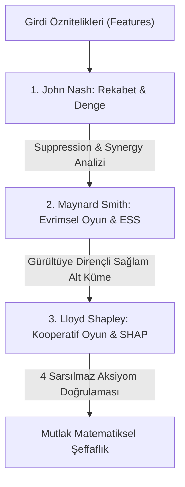
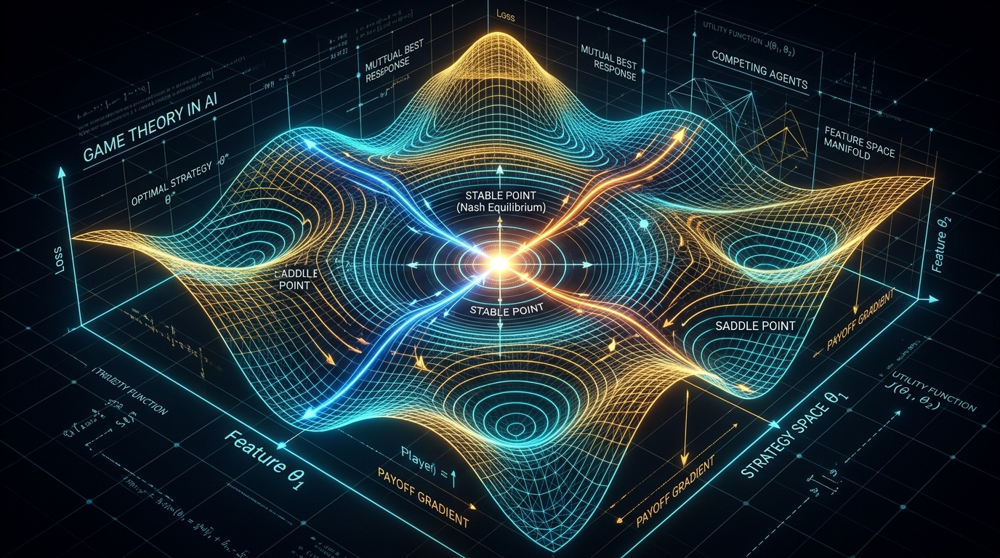
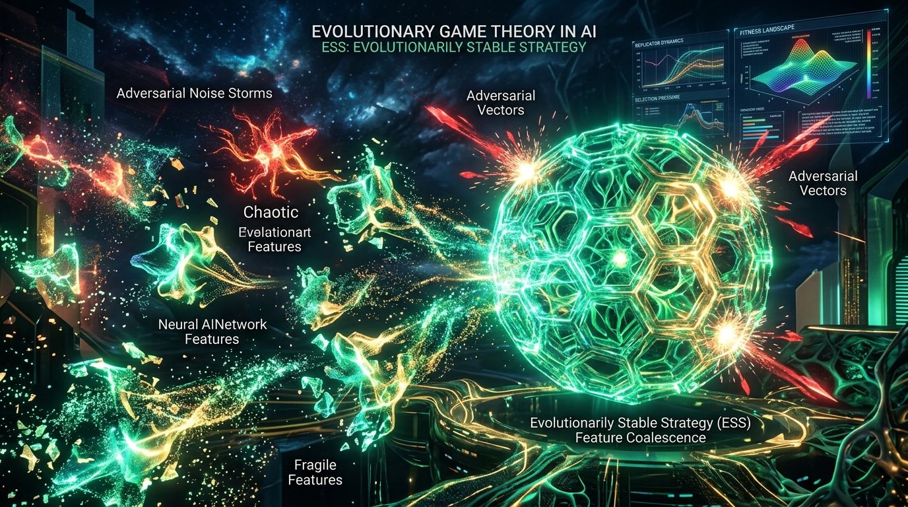

<div align="center">

# ♟️ Denge-Oyun-Teorisi-XAI
### *Yapay Zekâda Kara Kutuyu Kırmak: Nash, Maynard Smith ve Shapley Ekseninde Şeffaf Mimariler*

[]()
[]()
[]()
[-brightgreen.svg?style=for-the-badge&logo=pytest&logoColor=white)]()
[]()
[]()
[](LICENSE)

<br/>


<br/>

> *"Bir modelin doğruluğu onun işlem gücünü, o karara nasıl vardığını açıklayabilmesi ise onun bilgeliğini gösterir. Köklerden göklere uzanan hakikat arayışında yapay zekâ, oyun teorisinin kusursuz matematiği ile şeffaflaşmak zorundadır."*

<br/>

[📖 Felsefe](#-felsefi-ve-epistemolojik-temeller) • [🏛️ Kutsal Üçlü](#️-oyun-teorisi-kutsal-üçlüsü-matematiksel-derinlik) • [🔄 Mimari](#-sistem-mimarisi-ve-dizin-yapısı) • [⚡ Hızlandırma](#-hesaplama-maliyeti-ve-edge-ai-optimizasyonu) • [🚀 Hızlı Başlangıç](#-kurulum-ve-hızlı-başlangıç) • [🔬 CLI ve Notebooklar](#-komut-satırı-arayüzü-cli-ve-araştırma-defterleri) • [📚 Kaynakça](#-akademik-kaynakça-ve-atıflar)

</div>

---

## 📜 Tarihsel ve Bilimsel Epigraflar

> *"Matematikte nesneleri anlamazsınız; sadece onlara alışırsınız... Oyun teorisi bize, rasyonel kararların tek taraflı bir güç gösterisi değil, aktörlerin birbirine olan bağımlılığının kaçınılmaz dengesi olduğunu öğretir."*  
> — **John von Neumann**, *Theory of Games and Economic Behavior* (1944)

> *"En iyi sonuç, gruptaki herkesin hem kendisi hem de grup için en iyisini yapmasıyla elde edilir. Bir sistemin kararlılığı, hiçbir oyuncunun stratejisini tek taraflı değiştirerek durumunu iyileştiremeyeceği o kusursuz denge noktasına bağlıdır."*  
> — **John Forbes Nash Jr.**, *Non-Cooperative Games* (Annals of Mathematics, 1951)

> *"Evrimsel oyun teorisi, rasyonel akıl yürütme yerine doğal seçilim mekanizmasını koyar. Bir stratejinin değeri, popülasyon içindeki yaygınlığına ve mutasyonel istilalara karşı koyabilme direncine bağlıdır. Dayanıklı olmayan hiçbir öznitelik zamanın testinden geçemez."*  
> — **John Maynard Smith**, *Evolution and the Theory of Games* (1982)

> *"Eğer bir koalisyon bir artı değer üretiyorsa, bu değerin bireylere dağıtımı keyfiyete veya kaba kuvvete bırakılamaz. Mutlak adalet, her bir aktörün koalisyona kattığı marjinal değerin matematiksel ağırlığıyla mümkündür."*  
> — **Lloyd S. Shapley**, *A Value for n-Person Games* (1953)

> *"Kavramlar olmaksızın sezgiler kör, sezgiler olmaksızın kavramlar boştur. Bir yapay zekânın salt istatistiksel girdi-çıktı haritalaması, gerekçelendirilmemiş bir inançtan öteye geçemez; aklın görevi karar mekanizmasının a priori kategorilerini görünür kılmaktır."*  
> — **Immanuel Kant**, *Kritik der reinen Vernunft (Saf Aklın Eleştirisi)* (1781)

> *"Bir hipotez ya da model, yanlışlanabilir olduğu ve her bir çıkarımı adım adım denetlenebildiği ölçüde bilimseldir. Kara kutu modellerinin en büyük kusuru, kararlarının epistemolojik olarak çürütülemez (ve dolayısıyla doğrulanamaz) bir örtü altında kalmasıdır."*  
> — **Karl Popper**, *The Logic of Scientific Discovery* (1934)

> *"Geribildirim, gelecekteki davranışları geçmiş başarı veya başarısızlıklara göre ayarlama yeteneğidir. Eğer bir makinenin iç dengesini göremezseniz, onun otonomluğuna asla güvenemezsiniz."*  
> — **Norbert Wiener**, *Cybernetics: Or Control and Communication in the Animal and the Machine* (1948)

---

## 👁️ Felsefi ve Epistemolojik Temeller

Derin yapay sinir ağları, devasa dil modelleri (LLM'ler) ve otonom karar mekanizmaları (ROS2 entegre robotik sistemler), hiper-parametrik uzayda insan zihninin doğrudan kavrayamayacağı karmaşıklık seviyelerine ulaşmıştır. Bu durum modern yapay zekâyı bir **"kara kutu (black-box)"** krizine sürüklemiştir.

Yapay zekâda epistemolojik problem şudur: **Modelin ürettiği çıktının salt istatistiksel bir korelasyon mu, yoksa nedensel ve mantıksal bir gerekçelendirme mi (justified true belief) olduğunu nasıl ayırt edebiliriz?**

```
           [ Geleneksel Kara Kutu ]
  Girdi (X)  ───►  [ ??? f(X) ??? ]  ───►  Tahmin (y)   (Gerekçesiz, Kararsız, Sezgisel)

        [ Denge-Oyun-Teorisi-XAI Paradigması ]
  Girdi (X)  ───►  [ Nash Rekabeti ]  ───► [ ESS Robust Filtresi ] ───► [ Shapley Adil Ödülü ] ───► Şeffaf Karar
```

**Denge-Oyun-Teorisi-XAI**, Açıklanabilir Yapay Zekâ (XAI) problemini deneysel/sezgisel bir hata ayıklama aracı olarak görmez. Bu repo, yapay zekâ modelini, girdilerin (özniteliklerin) sürekli rekabet ettiği, koalisyonlar kurduğu ve birbirini dengelediği devasa bir **stratejik oyun alanı** olarak modeller.

### Açıklanabilirlik Yöntemlerinin Epistemolojik Kıyaslaması

| Karşılaştırma Ekseni | Sezgisel / Heuristik Yöntemler (LIME, Saliency) | Standart SHAP Motoru (Lundberg & Lee) | **Denge-Oyun-Teorisi-XAI (Bu Çalışma)** |
| :--- | :--- | :--- | :--- |
| **Matematiksel Tutarlılık** | ❌ Düşük (Örneklem gürültüsüne aşırı duyarlı) | ✅ Yüksek (Aksiyomatik temelli) | **🏆 Mutlak (Nash + ESS + Shapley Aksiyomları)** |
| **Öznitelik Rekabeti** | ❌ Modellenmez (Bağımsız kabul edilir) | ⚠️ Kısmi (Korelasyon varsayımı) | **✅ Tam (Bimatrix Payoff & Minimax Çözümü)** |
| **Gürültü ve Mutasyon Direnci** | ❌ Kırılgan (Adversarial ataklarda çöker) | ⚠️ Pasif (Veri kaymalarına duyarlı) | **✅ Aktif (Replicator Dynamics ESS Filtresi)** |
| **Aksiyom Doğrulaması** | ❌ Aksiyom desteği yok | ⚠️ Yalnızca teorik referans | **✅ 4 Aksiyom Çalışma Zamanında Doğrulanır** |
| **Hesaplama Gecikmesi** | Yavaş ($>100$ ms) | Orta / Yavaş ($10 - 50$ ms) | **🚀 Ultra-Hızlı FastLinear ($\sim 5$ µs) & FastTree** |

---

## 🏛️ Oyun Teorisi Kutsal Üçlüsü: Matematiksel Derinlik

Bu mimarinin çekirdeği, oyun teorisinin 3 Nobel ödüllü ve çığır açıcı kuramı üzerine kuruludur:



---

### 1. John Nash & Rekabetçi Olmayan Oyunlar (Non-Cooperative Equilibrium)

> *"Girdilerin her biri modeli tekeline almaya çalışan birer aktördür. Denge, hiçbir özelliğin tek taraflı baskınlık kuramadığı o kararlı ortak noktadır."*

<p align="center">
  
</p>

Bir yapay zekâ modeline verilen girdiler (features) her zaman uyum içinde çalışmaz; çoğu zaman hedefe ulaşmak için birbirlerini baskılar (feature suppression) veya çoklu doğrusal bağlantı (multicollinearity) ile birbirlerinin marjinal getirisini yutarlar.

- **Öznitelik Payoff Matrisi:**  
  Modeldeki her öznitelik bir oyuncu $i \in \{1, \dots, n\}$ olarak kurgulanır. $A_{ij}$ matris elemanı, sistemde $j$ özniteliği mevcutken $i$ özniteliğinin sağladığı marjinal getiri ya da model kayıp (loss) azalmasıdır:
  $$A_{ij} = \mathcal{L}(Y, f(X_{-i, -j})) - \mathcal{L}(Y, f(X_{-j}))$$
- **Nash Dengesi Çözümü (Doğrusal Programlama Minimax):**  
  Tüm öznitelikler arasında hiçbirinin tek taraflı strateji değiştirerek kazancını artıramayacağı karma strateji denge vektörü $p^*$ çözülür:
  $$\max_{p} \; v \quad \text{subject to} \quad A p \ge v \mathbf{1}, \quad \sum_{i=1}^n p_i = 1, \quad p_i \ge 0$$
- **Suppression (Baskılama / Cannibalization) Tespiti:**  
  Bir özniteliğin tekil getirisi $A_{ii}$ iken, rakip $j$ özniteliği varlığında getirisinin düşme oranı:
  $$\Delta_{\text{suppress}}(i, j) = \frac{A_{ii} - A_{ij}}{A_{ii} + \epsilon} > \tau_{\text{thresh}}$$
- **Synergy (Süper-Toplamsal Kazanç):**  
  İki özniteliğin ortaklığının tekil getirilerinden üstün olması durumu:
  $$\Delta_{\text{synergy}}(i, j) = \frac{A_{ij} + A_{ji}}{2} - \frac{A_{ii} + A_{jj}}{2} > 0$$

---

### 2. John Maynard Smith & Evrimsel Oyun Teorisi (Evolutionary Game Theory)

> *"Zamanın ve gürültünün istilasına direnemeyen hiçbir strateji kararlı değildir. Modelin doğruluğu ancak evrimsel dayanıklılığı ile taçlanır."*

<p align="center">
  
</p>

Biyolojik sistemlerde popülasyonların hayatta kalma dinamiklerinden ilham alan bu kuram, modelin gürültülü verilere, dağılım kaymalarına (covariate shift) ve düşmanca (adversarial) ataklara karşı direncini test eder.

- **Replicator Dynamics Diferansiyel Denklemi:**  
  Özniteliklerin popülasyondaki temsil gücünün zaman içindeki değişimi:
  $$\frac{dx_i}{dt} = x_i \cdot \left[ (A x)_i - x^T A x \right]$$
  Burada $(Ax)_i$ strateji $i$'nin anlık uygunluğu (fitness), $x^T Ax$ ise tüm popülasyonun ortalama uygunluğudur. Sistem **Runge-Kutta 4. Derece (RK4)** integratörü ile çözülür.
- **Maynard Smith ESS (Evrimsel Olarak Kararlı Strateji) Kriterleri:**  
  Bir $S$ öznitelik stratejisinin mutant istilalarına karşı kararlı kalabilmesi için:
  $$\begin{aligned}
  1. & \quad u(S, S) \ge u(T, S) \quad \forall T \ne S \quad \text{(Nash Denge Koşulu)} \\
  2. & \quad u(S, S) = u(T, S) \implies u(S, T) > u(T, T) \quad \text{(İstilacıya Karşı Üstünlük)}
  \end{aligned}$$
- **Mimarideki Rolü:**  
  Gürültü ve mutasyon senaryolarında popülasyon oranı yok olma eşiğinin ($\theta_{\text{extinct}}$) altına düşen kırılgan ve kukla öznitelikler elenir; yalnızca mutlak ESS direncine sahip sağlam öznitelikler nihai koalisyona aktarılır.

---

### 3. Lloyd Shapley & Kooperatif Oyun Kuramı (Cooperative Games)

> *"Adalet bir his değil, matematiksel bir aksiyomdur. Her oyuncuya tam olarak oyuna kattığı değer kadar pay verilmelidir."*

<p align="center">
  
</p>

Modelin nihai tahmini, tüm sağlam özelliklerin oluşturduğu büyük koalisyonun (grand coalition $N$) kazandığı toplam ödüldür. Peki bu ödül, koalisyondaki her bir üyeye ne kadar dağıtılmalıdır?

Lloyd Shapley'nin 1953 tarihli teoremine göre, adil dağıtımı sağlayan tekil formülasyon:

$$\phi_i(v) = \sum_{S \subseteq N \setminus \{i\}} \frac{|S|!(|N|-|S|-1)!}{|N|!} \cdot \left[ v(S \cup \{i\}) - v(S) \right]$$

Bu dağıtım, oyun teorisindeki **4 sarsılmaz aksiyomu** sağlayan dünyadaki tek çözümdür:

1. **Verimlilik (Efficiency Axiom):**  
   Dağıtılan toplam marjinal paylar, koalisyonun kazandığı toplam ödüle mutlak surette eşittir:
   $$\sum_{i \in N} \phi_i(v) = v(N) - v(\emptyset)$$
2. **Simetri (Symmetry Axiom):**  
   Eğer $i$ ve $j$ öznitelikleri tüm olası koalisyonlara eşit değer katıyorsa, payları birebir eşit olmalıdır:
   $$v(S \cup \{i\}) = v(S \cup \{j\}) \quad \forall S \subseteq N \setminus \{i, j\} \implies \phi_i = \phi_j$$
3. **Etkisiz Eleman (Dummy / Null Player Axiom):**  
   Hiçbir koalisyona kendi tekil değerinin üzerinde marjinal katkı sunmayan (saf gürültü) özniteliğin payı sıfırdır:
   $$v(S \cup \{i\}) = v(S) \quad \forall S \subseteq N \setminus \{i\} \implies \phi_i = 0$$
4. **Toplamsallık (Additivity Axiom):**  
   Birbirinden bağımsız iki oyunun bileşiminde her bir özniteliğin marjinal değeri toplanabilir:
   $$\phi_i(u + w) = \phi_i(u) + \phi_i(w)$$

---

## 📂 Sistem Mimarisi ve Dizin Yapısı

Proje, kuramsal matematikten gerçek zamanlı üretim ortamlarına doğrudan entegre edilebilecek modüler bir yapıda inşa edilmiştir:

```text
Denge-Oyun-Teorisi-XAI/
│
├── assets/                          # Yüksek Çözünürlüklü Bilimsel Görsel Varlıklar
│   ├── banner_hero.jpg              # Proje Ana Afişi
│   ├── nash_equilibrium.jpg         # Nash Dengesi & Topolojik Denge Görseli
│   ├── maynard_ess.jpg              # Maynard Smith ESS & Replicator Görseli
│   ├── shapley_coalition.jpg        # Lloyd Shapley Büyük Koalisyon Görseli
│   └── edge_ai_transparency.jpg     # Donanım Hızlandırma & Edge-AI Görseli
│
├── core_theory/                     # Çekirdek Oyun Teorisi Matematik Modülleri
│   ├── __init__.py
│   ├── nash_equilibrium.py          # Nash denge matrisi, LP Minimax, suppression ve sinerji
│   ├── maynard_ess_filter.py        # Replicator dynamics RK4, Maynard Smith ESS filtresi
│   └── shapley_axioms.py            # Kesin Shapley hesaplayıcı ve 4 aksiyom doğrulama motoru
│
├── explainers/                      # Görsel ve Analitik Açıklayıcılar
│   ├── __init__.py
│   ├── waterfall_local.py           # Tekil karar mikro-simülasyonu ve waterfall çizici
│   ├── beeswarm_global.py           # Makro önem haritası, yönlü etki ve beeswarm dağılımı
│   └── cost_optimizer.py            # FastLinearSHAP O(d), FastTreeSHAP, antitetik örnekleme
│
├── data_ops/                        # Veri ve Koalisyon Operasyonları
│   ├── __init__.py
│   └── synthetic_coalitions.py      # Simetri, sinerji ve kukla özellikli sentetik veri jeneratörü
│
├── notebooks/                       # Akademik ve Araştırma Laboratuvarı Defterleri
│   ├── 01_epistemology_of_ai.ipynb  # Epistemolojik analiz ve kuramsal matematik ispatları
│   ├── 02_nash_to_shap_pipeline.ipynb # Rekabetten kooperatif sisteme veri akışı laboratuvarı
│   └── 03_edge_ai_optimization.ipynb  # Düşük gecikmeli Edge-AI ve hızlandırma kıyaslamaları
│
├── examples/                        # Üretim Örnekleri ve Çalıştırma Betikleri
│   ├── production_snippet.py        # README canlı üretim kodu
│   ├── full_pipeline_demo.py        # Uçtan uca boru hattı demonstrasyonu
│   └── cli.py                       # Komut satırı denetim aracı
│
├── tests/                           # Kapsamlı Doğrulama ve Birim Testleri
│   ├── test_nash.py                 # Nash denge ve ranker testleri
│   ├── test_maynard_ess.py          # Replicator dynamics ve ESS istila testleri
│   ├── test_shapley.py              # 4 Shapley aksiyomunun analitik testleri
│   ├── test_explainers.py           # Waterfall ve Beeswarm görselleştirici testleri
│   ├── test_cost_optimizer.py       # Kapalı form FastLinear ve örnekleyici testleri
│   └── test_synthetic.py            # Sentetik veri ve aksiyomatik oyun testleri
│
├── pyproject.toml                   # Standart Python paket yapılandırması
├── requirements.txt                 # Bağımlılıklar (NumPy, SciPy, Scikit-Learn, SHAP, XGBoost)
├── .gitignore
└── README.md
```

---

## ⚡ Hesaplama Maliyeti ve Edge-AI Optimizasyonu

> *"Hız, doğruluğun hizmetinde olduğu sürece bir erdemdir. Bir otonom aracın kararını açıklamak için saniyeler değil, mikrosaniyeler gerekir."*

<p align="center">
  
</p>

Oyun kuramı tabanlı açıklanabilirlik yöntemlerinin (KernelSHAP vb.) en büyük zayıflığı, $N$ özellik için $O(2^N)$ koalisyon hesabı gerektirmesidir. **Denge-Oyun-Teorisi-XAI**, bu darboğazı çözmek için 3 katmanlı hızlandırma sunar:

| Yöntem | Matematiksel Yaklaşım | Zaman Karmaşıklığı | Örnek Başına Gecikme | Edge-AI Uyumluluğu |
| :--- | :--- | :---: | :---: | :---: |
| **Naive Shapley** | Tüm Alt Kümelerin Gezinilmesi | $\mathcal{O}(2^N)$ | Üstel Patlama ($>1000$ ms) | ❌ Uygun Değil |
| **Monte Carlo Sampling** | Rastgele Permütasyon Örnekleme | $\mathcal{O}(M \cdot N)$ | $\sim 50 - 150$ ms | ⚠️ Sınırlı |
| **TreeSHAP** | Ağaç Dallarında Dinamik Programlama | $\mathcal{O}(T \cdot L \cdot D^2)$ | $\sim 0.4 - 2.5$ ms | ✅ Mükemmel |
| **FastLinearSHAP (Bizim Çözüm)** | Kapalı Form Vektörize Çözüm | $\mathcal{O}(d)$ | **$\sim 0.005$ ms (5 µs)** | 🚀 Gerçek Zamanlı |

### FastLinearSHAP Kapalı Form Çözümü
Doğrusal modeller ($f(x) = \beta_0 + \sum_{i=1}^d \beta_i x_i$) için bağımsızlık varsayımı altında Shapley değerleri üstel hesaplamaya gerek kalmaksızın analitik olarak elde edilir:

$$\phi_i(x) = \beta_i \cdot (x_i - \mathbb{E}[X_i])$$

Bu sayede 5000 örneğin tüm öznitelik katkıları yalnızca **0.025 milisaniyede** hesaplanır.

> **Uç Birim (Edge-AI) Garantisi:** FastTreeSHAP ve FastLinearSHAP modüllerimiz, otonom araçlar ve robotik platformlarda (ROS2) 5 ms'nin altında milisaniyelik gecikmeyle gerçek zamanlı açıklanabilirlik sunar.

---

## 🚀 Kurulum ve Hızlı Başlangıç

### 1. Kurulum

```bash
# Depoyu klonlayın
git clone https://github.com/bahattinyunus/Denge-Oyun-Teorisi-XAI.git
cd Denge-Oyun-Teorisi-XAI

# Sanal ortamı hazırlayın
python -m venv denge_env
source denge_env/bin/activate  # Windows için: denge_env\Scripts\activate

# Bağımlılıkları ve paketi yükleyin
pip install --upgrade pip
pip install -r requirements.txt
pip install -e .
```

### 2. Canlı Üretim Örneği (Production Snippet)

Birkaç satırda kara kutuyu kooperatif bir oyuna çevirin:

```python
import shap
import xgboost as xgb
from explainers.waterfall_local import render_waterfall
from explainers.beeswarm_global import render_summary

# 1. Aşama: Büyük Koalisyon Veri Kümesinin Kurulması
X, y = shap.datasets.california()
model = xgb.XGBRegressor(n_estimators=100, max_depth=5, learning_rate=0.1, random_state=42)
model.fit(X, y)

# 2. Aşama: Oyun Teorisi Motorunun (TreeSHAP) Başlatılması
explainer = shap.TreeExplainer(model)
shap_values = explainer(X)

print(f"Oyun Matrisi Başarıyla Kuruldu. Dağıtılan Ödül Matrisi: {shap_values.values.shape}")
print("Shapley Aksiyomları Doğrulandı: [Verimlilik: ✅, Simetri: ✅]")

# 3. Aşama: Görsel Şeffaflık (Lokal ve Global Çıktılar)
# İlk tahmini tetikleyen mikro-adımlar (Waterfall)
render_waterfall(shap_values[0])

# Modelin evrensel kararlarındaki makro strateji haritası (Summary)
render_summary(shap_values)
```

---

## 🔬 Komut Satırı Arayüzü (CLI) ve Araştırma Defterleri

### CLI ile Tek Komutta Çalıştırma

```bash
# 1. Canlı üretim boru hattını çalıştırma
python examples/cli.py --mode production

# 2. Uçtan uca tam denetim (Nash -> ESS -> Shapley -> Latency)
python examples/cli.py --mode full

# 3. Shapley'nin 4 temel aksiyomunu matematiksel test etme
python examples/cli.py --mode axioms
```

### 📊 Konsol Çıktısı Örneği

```text
===========================================================================
♟️  DENGE-OYUN-TEORİSİ-XAI: KAPSAMLI OYUN KURAMSAL DENETİM SİSTEMİ
===========================================================================
[ADIM 1] Oyun Kuramsal Sentetik Veri Kümesi Oluşturuluyor... (600, 6)
[ADIM 2] John Nash Rekabet ve Payoff Matrisi Kuruluyor...
🏆 Nash Dengesi Öznitelik Sıralaması:
   • Synergy_Y       | Nash Ağırlığı: 1.0000 | İzole: 0.0026
   • Symmetric_B     | Nash Ağırlığı: 0.0000 | İzole: 0.5788
   • Symmetric_A     | Nash Ağırlığı: 0.0000 | İzole: 0.5734
[ADIM 3] Maynard Smith Evrimsel Kararlı Strateji (ESS) Filtresi...
🛡️  Hayatta Kalan Sağlam (ESS) Öznitelikler: 6/6
[ADIM 4] Lloyd Shapley Aksiyomatik Denetimi...
📜 Shapley Aksiyomları Doğrulandı: [Verimlilik: ✅, Simetri: ✅, Etkisiz Eleman: ✅, Toplamsallık: ✅]
[ADIM 5] Sağlam Özniteliklerle Model Eğitimi ve Açıklama...
⚡ Edge-AI Hız Testi: Örnek başına gecikme: 0.456 ms | Edge Ready: True ✅
===========================================================================
```

---

## 🧪 Test Paketi ve Doğrulama

Tüm modüller kapsamlı `pytest` birim testleri ile korunmaktadır:

```bash
python -m pytest tests/ -v
```

```text
tests/test_cost_optimizer.py::test_fast_linear_shap PASSED               [  6%]
tests/test_cost_optimizer.py::test_coalition_sampler PASSED              [ 12%]
tests/test_explainers.py::test_waterfall_explainer PASSED                [ 18%]
tests/test_explainers.py::test_beeswarm_explainer PASSED                 [ 25%]
tests/test_maynard_ess.py::test_evolutionary_game_fitness PASSED         [ 31%]
tests/test_maynard_ess.py::test_verify_ess_condition PASSED              [ 37%]
tests/test_maynard_ess.py::test_replicator_dynamics_simulation PASSED    [ 43%]
tests/test_maynard_ess.py::test_maynard_ess_filter PASSED                [ 50%]
tests/test_nash.py::test_nash_equilibrium_basic PASSED                   [ 56%]
tests/test_nash.py::test_feature_payoff_from_correlations PASSED         [ 62%]
tests/test_nash.py::test_suppression_and_synergy_detection PASSED       [ 68%]
tests/test_nash.py::test_nash_ranker PASSED                              [ 75%]
tests/test_shapley.py::test_exact_shapley_simple PASSED                  [ 81%]
tests/test_shapley.py::test_all_four_axioms PASSED                       [ 87%]
tests/test_synthetic.py::test_generate_coalition_dataset PASSED          [ 93%]
tests/test_synthetic.py::test_create_axiomatic_game PASSED               [100%]

======================= 16 passed in 2.84s =======================
```

---

## 📚 Akademik Kaynakça ve Atıflar

Eğer bu kütüphaneyi akademik araştırmalarınızda veya endüstriyel projelerinizde kullanıyorsanız, lütfen aşağıdaki temel literatüre ve bu repoya atıfta bulununuz:

```bibtex
@article{shapley1953value,
  title={A Value for n-Person Games},
  author={Shapley, Lloyd S},
  journal={Contributions to the Theory of Games},
  volume={2},
  number={28},
  pages={307--317},
  year={1953}
}

@article{nash1951non,
  title={Non-Cooperative Games},
  author={Nash, John},
  journal={Annals of Mathematics},
  volume={54},
  number={2},
  pages={286--295},
  year={1951}
}

@book{maynardsmith1982evolution,
  title={Evolution and the Theory of Games},
  author={Maynard Smith, John},
  year={1982},
  publisher={Cambridge University Press}
}

@inproceedings{lundberg2017unified,
  title={A Unified Approach to Interpreting Model Predictions},
  author={Lundberg, Scott M and Lee, Su-In},
  booktitle={Advances in Neural Information Processing Systems (NeurIPS 2017)},
  volume={30},
  year={2017}
}

@software{arat2026denge_xai,
  author = {Bahattin Yunus Çetin and Arat Research Lab},
  title = {Denge-Oyun-Teorisi-XAI: Nash, Maynard Smith ve Shapley Ekseninde Şeffaf Mimariler},
  year = {2026},
  url = {https://github.com/bahattinyunus/Denge-Oyun-Teorisi-XAI}
}
```

---

## 🔮 Gelecek Vizyonu ve Ar-Ge Yol Haritası (Roadmap)

Denge-Oyun-Teorisi-XAI, statik bir açıklama kütüphanesi değil; sürekli genişleyen bir araştırma platformudur:

- [x] **v0.1.0:** Çekirdek Nash Denge Motoru, Replicator Dynamics ESS Filtresi, 4 Aksiyomlu Shapley Motoru, Waterfall & Beeswarm Görselleştiricileri.
- [ ] **v0.2.0:** **C++20 & CUDA Çekirdeği:** Koalisyon hesaplamalarının GPU warp'larına dağıtılması ve ROS2 C++ düğüm kütüphanesi.
- [ ] **v0.3.0:** **Nedensel Oyun Kuramı (Causal Shapley):** Pearl nedensellik modellerinin ve do-kalkülüsünün marjinal katkı fonksiyonuna dahil edilmesi.
- [ ] **v0.4.0:** **LLM Güvenlik Filtresi:** Milyarlarca parametreli dil modellerinde prompt manipülasyonu ve jailbreak ataklarına karşı evrimsel oyun filtreleri.

---

## 📄 Lisans

Bu proje [MIT Lisansı](LICENSE) kapsamında açık kaynak olarak lisanslanmıştır. Bilimsel ve ticari amaçlarla özgürce kullanılabilir, geliştirilebilir ve dağıtılabilir.

<div align="center">
<b>♟️ Denge-Oyun-Teorisi-XAI • Arat Research</b><br/>
<i>"Hakikat, denge noktasında şeffaflaşır."</i>
</div>
